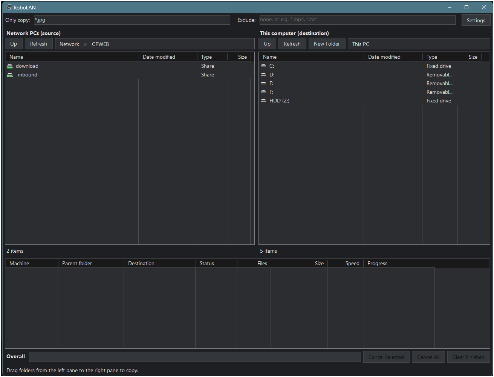
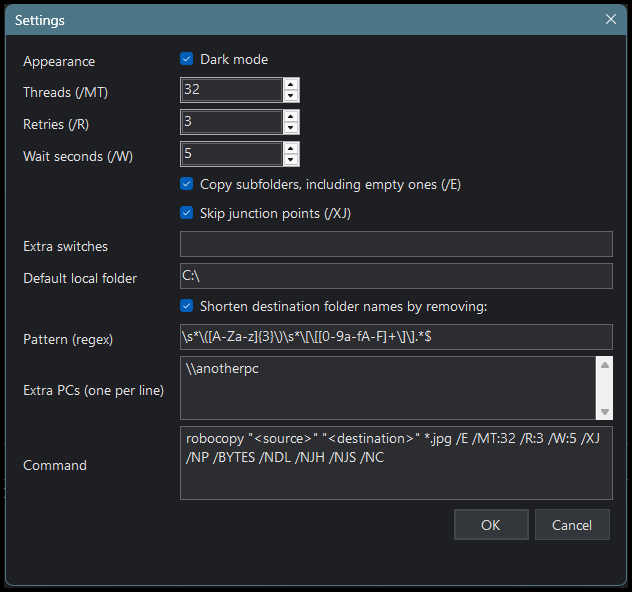

# RoboLAN

A small Windows app for copying folders from other PCs on your network with robocopy, by drag and drop.



The left pane shows the PCs on your network, then their shared folders and subfolders. The right pane shows your own drives and folders. Both panes look like Explorer's Details view (name and date modified), and both have a path bar you can click and type or paste into, including `\\PCNAME` for PCs that Explorer doesn't list.

Drag one or more folders from the left pane onto a folder in the right pane, and RoboLAN runs robocopy for each one, for example:

```
robocopy "\\PC\share\Some folder" "D:\Copies\Some folder" /E /MT:32 /R:3 /W:5 /XJ
```

## Download

Get `RoboLAN.exe` from the [latest release](https://github.com/redwo1f/RoboLAN/releases/latest). It's a single file with no installer, so put it in any folder and run it.

It needs the free [.NET Desktop Runtime](https://dotnet.microsoft.com/download/dotnet) (version 7 or later, and the newest one you have is used). If it's missing, Windows offers to download it the first time you run RoboLAN. The exe isn't code-signed, so Windows SmartScreen may warn you the first time; choose "More info", then "Run anyway".

## How it works

- **Scan, then copy.** Each dropped folder is first scanned with robocopy's list-only mode (`/L`) to count its files and bytes, then copied for real. That count drives the progress bars.
- **One queue per PC.** Folders from the same PC copy one after another. Folders from different PCs copy at the same time.
- **Progress.** The bottom list shows each folder's source PC, destination, status (Waiting, Scanning, Queued, Copying, Done, Failed), files, size, live speed and progress. The line below it shows overall progress, the combined current speed and an estimate of time left.
- **Live speed** comes from the bytes the robocopy process has read over the last 10 seconds, so it stays accurate on slow links where robocopy reports finished files only in batches.
- **Filters.** "Only copy" (e.g. `*.jpg, *.png`) and "Exclude" (e.g. `*.mp4, *.txt`) boxes above the list apply to the next drop.
- **Cancel and resume.** Cancel stops the copy and keeps partly copied files. Dropping the same folder again resumes, since robocopy skips files that are already there.
- **Log.** Start, end, speed every 5 minutes and any robocopy errors go to `RoboLAN-log.txt` beside the exe.

## Settings

The Settings button sets robocopy's thread count (`/MT`), retries (`/R`), wait time (`/W`), subfolders (`/E`), skipping junctions (`/XJ`), extra switches, the default local folder (`C:\` until you change it), extra PC names to always list, an optional regex for shortening destination folder names, and dark or light theme. It shows a preview of the full command.



Settings and the window layout (size, splitters, column widths, sort order) are saved to `%APPDATA%\RoboLAN\settings.json`.

## Requirements and building

- Windows 10 or 11 with robocopy (built in).
- .NET 7 or later Desktop Runtime to run it, and the .NET 7 SDK or later to build it.

Build a single-file exe:

```
dotnet publish -c Release -r win-x64 --self-contained false -p:PublishSingleFile=true -o dist
```

## Notes

- Robocopy flags in "Extra switches" are passed straight through. `/MIR`, `/PURGE`, `/MOV` and `/MOVE` delete files, so RoboLAN asks for confirmation when you save them and again before each copy that uses them.
- Exit codes 0 to 7 count as success and 8 or higher as failure, as robocopy defines them.

## License

MIT. See [LICENSE](LICENSE).
